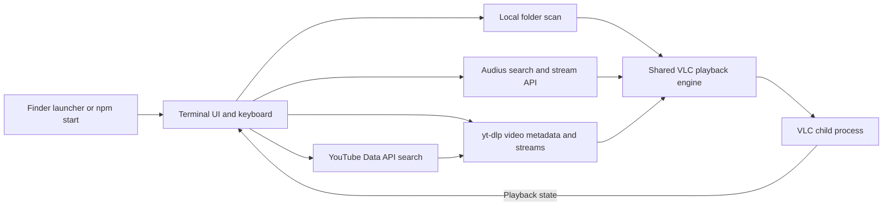

# CHILL AVVU MAMA

CHILL AVVU MAMA is a terminal multimedia player for macOS. Play audio from a local folder, search Audius, or watch a YouTube video in VLC. All three modes share keyboard controls and let you return to the mode menu without restarting.

## Install and launch on macOS

1. Install [Node.js 22 or newer](https://nodejs.org/en/download) and [VLC 3 for macOS](https://www.videolan.org/vlc/download-macosx.html). Drag VLC into **Applications**. Install yt-dlp for YouTube playback.
2. In Finder, open the project folder and double-click **CHILL AVVU MAMA.command**. Terminal opens at the welcome screen.
3. Press **Enter**, choose a mode with the arrow keys, then press **Enter** again.

The launcher is executable in Git. If a copied or extracted launcher lost that permission, run this once from the project directory.

```sh
chmod +x "CHILL AVVU MAMA.command"
```

For development, run these commands in the project directory.

```sh
npm ci
npm test
npm start
```

If you use Homebrew, install the required software with these commands.

```sh
brew install node yt-dlp
brew install --cask vlc
```

Keep yt-dlp current as YouTube changes its streaming implementation.

```sh
brew update
brew upgrade yt-dlp
```

The app uses CommonJS, Node's built-in readline, Fetch, and test runner. It has zero npm runtime dependencies. VLC and yt-dlp are separate installations. yt-dlp runs the same Node executable as the player for its JavaScript runtime. Install a current yt-dlp distribution with its YouTube JavaScript support components. Alternative installation methods are documented by [yt-dlp](https://github.com/yt-dlp/yt-dlp#installation).

## Offline music

Choose **Offline Music**. Press Enter at the folder prompt to open the project's `songs/` folder. To use another folder, type or paste its plain path, including spaces, and press Enter. Absolute paths, paths relative to the current working directory, and paths starting with `~/` work. The Finder launcher starts in the project directory.

The player lists files in that folder with MP3, WAV, FLAC, M4A, AAC, AIF, or AIFF extensions. VLC handles decoding. Subdirectories are skipped. If the folder is empty, press **S** to choose another. If the path is invalid, correct it at the prompt.

## Online music

Choose **Online Music**, type a title, artist, or keyword, and press Enter. Use the arrow keys to highlight a result, then press Enter to play. Results show the track title, artist, and duration when Audius supplies it. Press **S** to search again.

The [Audius REST API](https://docs.audius.co/api/) supplies both the results and streaming authorization. The app searches with `GET /v1/tracks/search`, then calls `GET /v1/tracks/{track_id}/stream` when you pick a track. VLC receives the HTTPS media URL issued by Audius. The app streams audio without saving a local song file.

Public search and streaming work without credentials. Configuration is optional. Copy `.env.example` to `.env` in the project root to set any of these values.

| Variable | When to use it |
| --- | --- |
| `VLC_PATH` | Use an executable at a custom location. The default checks `/Applications/VLC.app/Contents/MacOS/VLC` and then the shell PATH. |
| `AUDIUS_BEARER_TOKEN` | Authenticate read-only search requests with a token from your Audius API plan. The token stays in Node and is sent only to the official Audius API. |
| `AUDIUS_API_KEY` | Supply the optional public app key supported by the stream endpoint. |

## YouTube video

Choose **YouTube Video Player**, the third entry in the main menu. Paste a video URL or enter search keywords, then press Enter. URLs work without a YouTube Data API key. Supported video links include `youtube.com/watch?v=…`, `youtu.be/…`, and YouTube `/shorts/`, `/live/`, `/embed/`, and `/v/` links. Mobile and music YouTube watch links also work. A video ID must identify one video. Playlist-only and channel URLs are rejected.

For a pasted URL, yt-dlp retrieves the video's title, channel, and duration and displays one result. For keywords, the official YouTube Data API returns up to ten results. Each result shows its metadata and video URL. Use ↑/↓ to select a result and Enter to play. Press **S** to paste a different URL or search again.

VLC opens a separate video window. On macOS, the player loads VLC's macOS interface together with its remote-control interface so video windows and terminal controls are both available. Keep Terminal focused when using the CLI keyboard shortcuts. Both video and audio are requested. When YouTube provides separate streams, VLC receives the audio through its input-slave option. Combined streams are preferred. The player resolves fresh stream URLs for each playback attempt and asks yt-dlp to check format availability before handing a stream to VLC. It stops the previous VLC process before starting another. Leaving the mode or quitting also terminates any pending yt-dlp lookup.

yt-dlp runs with configuration files disabled, metadata-only output, and downloads skipped. The player does not save videos or merge media files. Use videos you are authorized to access and play.

### Configure keyword search

1. Create or select a project in [Google Cloud Console](https://console.cloud.google.com/).
2. Enable **YouTube Data API v3** and create an API key under **APIs & Services → Credentials**. Restrict the key to YouTube Data API v3. This local application sends requests from Node, so browser HTTP-referrer restrictions are unsuitable.
3. Copy the example configuration if you do not already have a `.env` file.

```sh
cp .env.example .env
```

4. Add your key to `.env`, preserving any existing VLC or Audius configuration, then restart the app.

```dotenv
YOUTUBE_API_KEY=your_key_here
# Optional when yt-dlp is installed outside PATH
# YT_DLP_PATH=/opt/homebrew/bin/yt-dlp
```

Search uses the documented [`search.list`](https://developers.google.com/youtube/v3/docs/search/list) and [`videos.list`](https://developers.google.com/youtube/v3/docs/videos/list) endpoints. Searches consume your project's quota and need an internet connection. A missing key produces a setup message, and you can paste a URL instead. See Google's [setup guide](https://developers.google.com/youtube/v3/getting-started) for credentials and quota details.

## Keyboard controls

| Key | Action |
| --- | --- |
| ↑ / ↓ | Move the selection |
| Enter | Open the selected mode or play the selected track |
| Space / P | Pause or resume. Start the selected track when stopped |
| ← / → | Play the previous or next track, wrapping at the ends |
| + / − | Change volume by 10 percentage points |
| X | Stop playback |
| S | Search again, paste another YouTube URL, or choose a new local folder |
| B | Return from the track list to the mode menu |
| Esc | Cancel a text prompt or return from the track list |
| Q | Quit from the welcome screen, menu, or track list |
| Ctrl+C | Quit from anywhere and restore the terminal |

At a text prompt, letters and spaces go into the folder path or search query.

## Architecture



- `start.js` and `src/index.js` load local configuration and open the app.
- `src/app.js` manages navigation, input, and outstanding requests. `src/ui/screen.js` renders each screen.
- `src/modes/offlineMode.js` scans local folders. `src/services/audiusApi.js` handles search and authorized streams.
- `src/modes/youtubeMode.js` routes pasted URLs and search queries. `src/services/youtubeService.js` validates video URLs, calls the official search API, and manages yt-dlp extraction, cancellation, and timeouts.
- `src/player/vlcPlayer.js` starts, controls, and stops one VLC child process at a time.

## Troubleshooting

| Symptom | What to check |
| --- | --- |
| Finder launcher reports missing Node.js | Install Node.js 22 or newer. If you use a version manager, ensure Node is available in a macOS login shell. |
| VLC is missing | Install VLC 3 in Applications or set `VLC_PATH` to the executable inside the app bundle. |
| VLC cannot open an audio device | Select a working output in macOS **System Settings → Sound** and try again. |
| Audius cannot be reached | Check your connection, then retry the search. |
| Audius reports a rate limit | Wait as directed and retry. Consider configuring your Audius plan's search token if you regularly hit the anonymous limit. |
| One result is unavailable | Pick another result. Availability depends on the uploader and Audius restrictions. |
| yt-dlp is missing | Run `brew install yt-dlp`, or set `YT_DLP_PATH` to its executable. |
| YouTube search needs a key | Enable YouTube Data API v3 and configure `YOUTUBE_API_KEY` in `.env`. |
| YouTube search is denied | Check API enablement, key restrictions, and remaining quota in your Google Cloud project. |
| A YouTube video cannot be opened | Update yt-dlp and try another public video. Private, age-restricted, region-blocked, deleted, or sign-in-required videos may be unavailable. |
| The media server rejects a stream with HTTP 403 | Press Enter to resolve and validate a fresh stream. If it continues, update yt-dlp or choose another video. |
| Video keyboard controls do not respond | Click back into Terminal. The shortcuts are handled by the terminal application. |

## Known limitations

- Audius offers its own catalog. The player supports public streams and has no Audius sign-in, purchases, or gated-track playback.
- Audius search shows up to 25 results, and YouTube search shows up to ten. Offline scanning is limited to one folder at a time.
- YouTube requires an up-to-date yt-dlp with JavaScript support. Direct stream URLs expire and availability can change. The integration has no cookie import, account login, or access-restriction bypass.
- Separate YouTube audio/video streams use VLC's experimental input-slave support. Synchronization and visible video/audio output require testing on your Mac. URL time offsets and playlist queues are not supported. Live streams depend on the formats yt-dlp can resolve.
- Playback controls target VLC 3's remote-control interface. Finder launch requires macOS.
- Fourteen MP3s were already tracked in this repository. Several filenames suggest commercial recordings, and the repository contains no documented redistribution permissions for them. Use audio you have rights to distribute when sharing the project. New files in `songs/` are ignored by Git by default.

Potential improvements include playlist saving, search pagination, and optional recursive folder scanning.

## Testing

Run `npm test` for automated tests with mocked YouTube, Audius, yt-dlp, and VLC boundaries. Tests cover URL validation, official search response handling, video metadata, separate audio/video handoff, network and process failures, keyboard controls, cancellation, and returning to the menu. These tests run without API keys, yt-dlp, or VLC installed.

Development verification also resolved the public “Me at the zoo” video with yt-dlp and streamed it through VLC with dummy video/audio outputs. VLC acknowledged play, pause, resume, and cleanup. A separate-stream check reported decoded video frames and audio buffers. The macOS launcher passed a pseudo-terminal check covering mode selection, missing yt-dlp recovery, offline navigation, quit, and terminal restoration. Visible video and audible output still need real-device testing. Live keyword search also returned ten results using a locally configured YouTube Data API key, and the installed yt-dlp resolved a selected result for VLC playback.

For a real playback check, launch the app from Terminal or Finder, select YouTube mode, paste a public video URL, select the result, and confirm visible video and audible audio. Test pause/resume, volume, next/previous, back, and quit with Terminal focused. To test a queue with multiple videos, configure a search key and select results from a keyword search. Automated mocks do not establish real audio/video playback.
