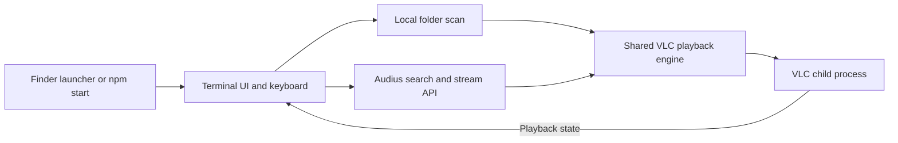

# CHILL AVVU MAMA

CHILL AVVU MAMA is a terminal music player for macOS. Play audio from a local folder or search Audius and stream tracks available for public playback. Both modes use the same VLC controls and let you return to the mode menu without restarting.

## Install and launch on macOS

1. Install [Node.js 22 or newer](https://nodejs.org/en/download) and [VLC 3 for macOS](https://www.videolan.org/vlc/download-macosx.html). Drag VLC into **Applications**.
2. In Finder, open the project folder and double-click **CHILL AVVU MAMA.command**. Terminal opens at the welcome screen.
3. Press **Enter**, choose a mode with the arrow keys, then press **Enter** again.

The launcher is executable in Git. If a copied or extracted launcher lost that permission, run this once from the project directory.

```sh
chmod +x "CHILL AVVU MAMA.command"
```

For development, run these commands in the project directory.

```sh
npm ci
npm test
npm start
```

The app uses CommonJS, Node's built-in readline, Fetch, and test runner. It has zero npm runtime dependencies. VLC is a separate installation.

## Offline music

Choose **Offline Music**. Press Enter at the folder prompt to open the project's `songs/` folder. To use another folder, type or paste its plain path, including spaces, and press Enter. Absolute paths, paths relative to the current working directory, and paths starting with `~/` work. The Finder launcher starts in the project directory.

The player lists files in that folder with MP3, WAV, FLAC, M4A, AAC, AIF, or AIFF extensions. VLC handles decoding. Subdirectories are skipped. If the folder is empty, press **S** to choose another. If the path is invalid, correct it at the prompt.

## Online music

Choose **Online Music**, type a title, artist, or keyword, and press Enter. Use the arrow keys to highlight a result, then press Enter to play. Results show the track title, artist, and duration when Audius supplies it. Press **S** to search again.

The [Audius REST API](https://docs.audius.co/api/) supplies both the results and streaming authorization. The app searches with `GET /v1/tracks/search`, then calls `GET /v1/tracks/{track_id}/stream` when you pick a track. VLC receives the HTTPS media URL issued by Audius. The app streams audio without saving a local song file.

Public search and streaming work without credentials. Configuration is optional. Copy `.env.example` to `.env` in the project root to set any of these values.

| Variable | When to use it |
| --- | --- |
| `VLC_PATH` | Use an executable at a custom location. The default checks `/Applications/VLC.app/Contents/MacOS/VLC` and then the shell PATH. |
| `AUDIUS_BEARER_TOKEN` | Authenticate read-only search requests with a token from your Audius API plan. The token stays in Node and is sent only to the official Audius API. |
| `AUDIUS_API_KEY` | Supply the optional public app key supported by the stream endpoint. |

## Keyboard controls

| Key | Action |
| --- | --- |
| ↑ / ↓ | Move the selection |
| Enter | Open the selected mode or play the selected track |
| Space / P | Pause or resume. Start the selected track when stopped |
| ← / → | Play the previous or next track, wrapping at the ends |
| + / − | Change volume by 10 percentage points |
| X | Stop playback |
| S | Search again or choose a new local folder |
| B | Return from the track list to the mode menu |
| Esc | Cancel a text prompt or return from the track list |
| Q | Quit from the welcome screen, menu, or track list |
| Ctrl+C | Quit from anywhere and restore the terminal |

At a text prompt, letters and spaces go into the folder path or search query.

## Architecture



- `start.js` and `src/index.js` load local configuration and open the app.
- `src/app.js` manages navigation, input, and outstanding requests. `src/ui/screen.js` renders each screen.
- `src/modes/offlineMode.js` scans local folders. `src/services/audiusApi.js` handles search and authorized streams.
- `src/player/vlcPlayer.js` starts, controls, and stops one VLC child process at a time.

## Troubleshooting

| Symptom | What to check |
| --- | --- |
| Finder launcher reports missing Node.js | Install Node.js 22 or newer. If you use a version manager, ensure Node is available in a macOS login shell. |
| VLC is missing | Install VLC 3 in Applications or set `VLC_PATH` to the executable inside the app bundle. |
| VLC cannot open an audio device | Select a working output in macOS **System Settings → Sound** and try again. |
| Audius cannot be reached | Check your connection, then retry the search. |
| Audius reports a rate limit | Wait as directed and retry. Consider configuring your Audius plan's search token if you regularly hit the anonymous limit. |
| One result is unavailable | Pick another result. Availability depends on the uploader and Audius restrictions. |

## Known limitations

- Audius offers its own catalog. The player supports public streams and has no Audius sign-in, purchases, or gated-track playback.
- Each search shows up to 25 results. Offline scanning is limited to one folder at a time.
- Playback controls target VLC 3's remote-control interface. Finder launch requires macOS.
- Fourteen MP3s were already tracked in this repository. Several filenames suggest commercial recordings, and the repository contains no documented redistribution permissions for them. Use audio you have rights to distribute when sharing the project. New files in `songs/` are ignored by Git by default.

Potential improvements include playlist saving, search pagination, and optional recursive folder scanning.
